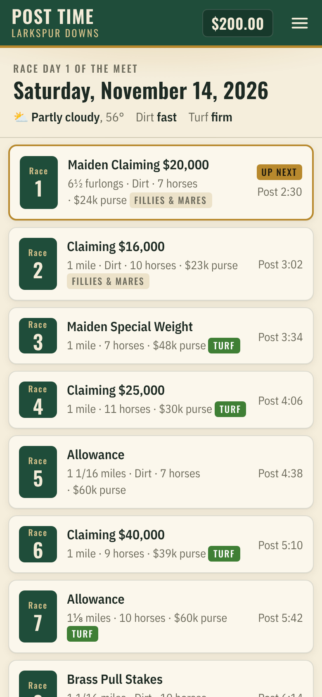
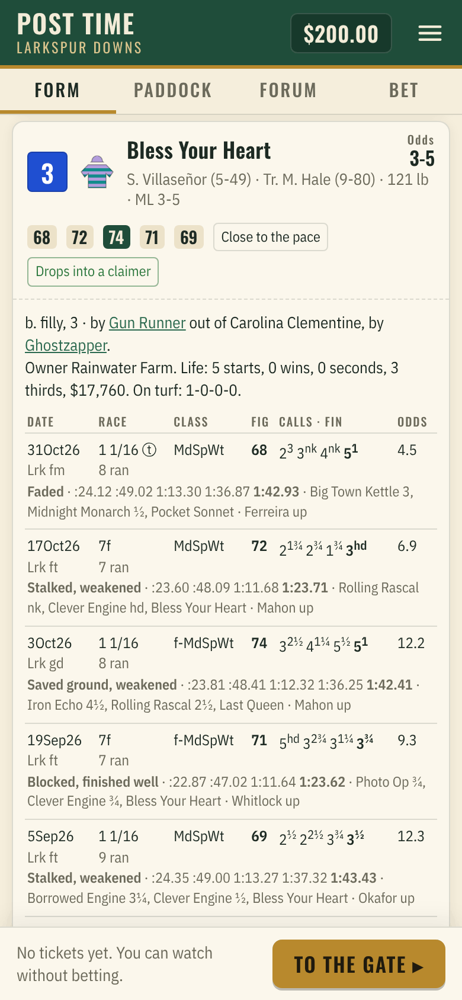
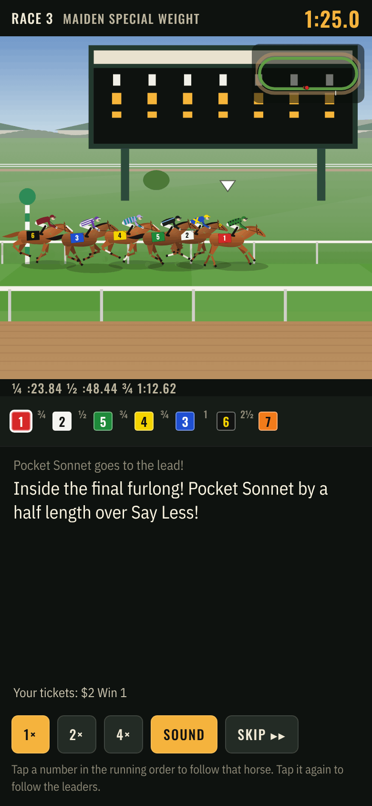
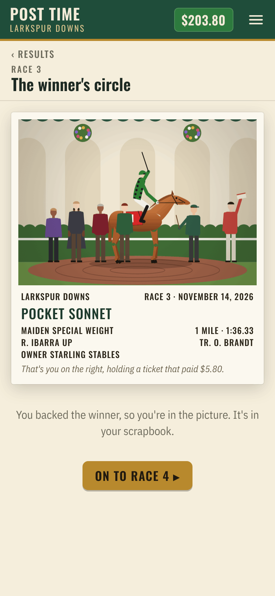

# Post Time

**Play it: [post-time.junkdrawer.works](https://post-time.junkdrawer.works/)**

**A day at the races at Larkspur Downs, a made-up track with eight races every Saturday.** Read the form, look the horses over in the paddock, see who the regulars on the forum like, and buy tickets at the window while the odds move. Then watch the race from the gate to the wire, with a caller, a running order and, when it's close, a photo finish. Your bankroll and the horses carry over from one race day to the next.

<p align="center">
  
  &nbsp;
  
  &nbsp;
  
  &nbsp;
  
</p>

## How it plays

- **The form is real.** The meet starts with ten weeks of races already run, simulated the same way as the ones you watch. Every speed figure, running line, trip comment and workout in a horse's past performances happened.
- **The race.** Each horse has a speed it can keep up all race and a reserve of extra it can spend above that, and going fast costs far more than going a little faster. So speed horses who duel for the lead tire each other out, and a lone speed horse left alone up front often wins. Horses save ground on the rail, lose it going wide on the turns, get stuck behind tiring horses and swing out to find room. Riders drawn wide tuck in before the first turn, and the rail horse gets squeezed if it doesn't break sharply. Dirt races go fast early and the field tires late, as American dirt races do.
- **Handicapping angles.** First time on turf, cutting back in distance, dropping in class, a new barn after a claim, a bullet workout, a troubled trip last time. Sires carry real tendencies: some get horses that love grass, or mud, or a long way. Sire names link to [Bloodlines](https://junkdrawer.works/bloodlines/).
- **The paddock.** How a horse looks before the race says something about how it feels today, and "washed out" is bad news.
- **The forum.** Seven regulars, each with a system: speed figures, the favorite, pace, pedigree, longshots, the look of a horse in the paddock, and one who always bets the grey. Their records are kept, so you can see which of them to listen to. They have plenty to say after the race too.
- **The tote.** Win, place, show, across the board, exacta and trifecta, straight or boxed. Money goes into pari-mutuel pools, the track takes its cut, and the odds move as minutes to post tick down. The late money knows a little more than the early money.
- **Watching.** A camera beside the track follows the leaders, swinging round the turns so the grandstand and the hills sweep past. There's a running order with margins, fractions on the clock, a map of the oval, and the caller, who runs down the field between the things that happen (a new leader, the fractions, the turn for home) and calls the stretch stride by stride. The browser can read the call aloud if you ask it to (in the menu), in the best voice it has, one you pick there, or Joe's (below), at 1x, 2x or 4x: each line is sized to be over before the next thing happens. Tap a horse's number to follow it. Close finishes go to slow motion, then to a photo: a real slit-camera picture made from the recorded race, so the horses come out stretched and squashed the way finish photos do.
- **Joe, the track's caller.** A browser's own voices differ from one device to the next, and on some devices they go up in pitch when they're hurried. So the list of voices in the menu has Joe: a voice the game downloads once, when you ask for it (76 MB), and keeps on the device. He's the same on every phone and computer, he calls at a quicker clip than a browser's voice is asked to, and he picks it up again over the last half minute to the wire, by talking faster, not by being played faster. His lines for a race are made while you read its form; on a device too slow to have them ready, the browser's voice calls that race, and the menu says so. Joe is Piper's `en_US-joe-medium` voice, whose model card gives its licence as CC0. The program that runs it is under the MIT licence, and the part that turns written words into the sounds he says, espeak-ng, is under the GNU General Public License, version 3 or later: [`voice/NOTICE`](voice/NOTICE) says what each file is, where it came from and where its source is.
- **A meet.** Ten race days, with the Larkspur Handicap ($300,000, a mile and an eighth on the dirt) on closing day. The card counts down to it, every Saturday's last race is a stakes, and the first two home in each are pointed to the Handicap and entered in it first. After it the meet closes with its leading rider and trainer, its horse of the meet, the forum's champion, the longest-priced winner and your own meet, and the next meet opens the Saturday after with the same horses and your bankroll. The scrapbook keeps each meet's record and photos.
- **The winner's circle.** Back the winner and you're in the photograph, holding your ticket. It goes in your scrapbook.
- No account and no server. The racing world, your bankroll and your scrapbook stay in your browser. It works offline and installs to a phone's home screen.
- **A copy of your meet.** Save a copy, in the menu, downloads the whole meet (horses, form, bankroll, tickets, scrapbook) as one file, about half a megabyte at the start of a meet and a megabyte or so after sixty race days. Open a copy reads one back, on the same device or another, checks it the way a save is checked when the page opens, and takes a second tap to put it in place of the meet there. Each device keeps its own sound and voice settings.

## Running it

It's a static site: plain HTML, CSS and JavaScript, with no build step.

```sh
npx serve .                   # or any static file server, then open the printed address
npm test                      # checks the racing logic in Node, then plays a race in Chromium (needs Playwright)
npm run sim                   # plays a few meets with nobody watching: how often favorites win, how much the odds move, what ways of betting get back
npm install                   # once, for the screenshot tool's PNG compressor and the bundler
node tools/screenshots.mjs    # redraws docs/*.png and og.png
node tools/make-icons.mjs     # redraws the PNG icons from icon.svg
npm run build                 # bundles everything into dist/post-time.html, one file you can send around
```

To put it online with GitHub Pages: **Settings → Pages → Build and deployment → Deploy from a branch**, then pick `main` and `/ (root)`.

### Files

- `index.html`, `css/app.css`: the page and how it looks. `carry.js` runs first on the page: on the first visit to post-time.junkdrawer.works it brings saves over from the game's old address, junkdrawer.works/post-time/, and anywhere else it does nothing.
- `js/sim.js`: the race: pace, stamina, traffic and ground lost on the turns. Recorded frame by frame for playback.
- `js/track.js`: the one-mile dirt oval, the seven-furlong turf course inside it, chutes and distance poles.
- `js/world.js`: the barn of horses, the race cards, the meet (ten race days to the Handicap, and its record), and turning a finished race into past performances.
- `js/handicap.js`, `js/forum.js`: what the public can see, the morning line, and the forum regulars' systems.
- `js/tote.js`: pari-mutuel pools, moving odds and payouts.
- `js/call.js`, `js/chart.js`: the race caller (a schedule made at the gate: what's coming, and for each moment the voice is free the most pressing thing to say, in a wording short enough to be over in time), trip comments and running lines.
- `js/draw/`: the horses and riders, the view from beside the track, the photo finish and the winner's circle.
- `js/ui/`, `js/game.js`, `js/app.js`: the screens, your bankroll and tickets, and saving.
- `js/copy.js`: Save a copy and Open a copy (the file is `js/game.js`'s copy of the meet).
- `js/audio.js`: the bugle, the starting bell, the crowd and the cash window, all synthesised, and the browser's voice reading the call: which voice it uses, the pace each kind of device really gives it, how long it takes over a line, and the queue that lets a line finish before the next is said.
- `js/joe.js`, `js/joe-worker.js`, `js/joe-speech.js`: the caller's downloaded voice, Joe. The download and where it's kept (a cache of its own, which an update of the game leaves alone); a worker that turns a line of text into sound at the speed asked, by having the voice's model talk faster, never by playing the sound faster; and the arithmetic between the two, which the tests hold to what Python Piper makes of the same lines.
- `js/joe-call.js`: Joe calling a race. His pace (1.3 times his own speed, up to 1.5 at the wire), about how long he takes over a line (the call is planned with it), the clips of a race's call, made ahead and held to the room the plan left each of them, and whether the device can make them in time. `js/audio.js` plays them through the same queue as the browser's voice, and decides as a race goes to the gate which of the two calls it.
- `voice/`: Joe's files, which are other people's work: the voice's model in four parts, onnxruntime-web to run it, and a phonemizer with espeak-ng's data for English. `voice/NOTICE` says what each is, where it came from and its licence; `voice/manifest.json` lists what is downloaded (76 MB), and nothing of it is fetched until the player asks for the voice in the menu.
- `fonts/`: Oswald and IBM Plex Sans Condensed (SIL Open Font License), served from here so nothing loads from elsewhere.
- `sw.js`: keeps a copy for playing offline. On a connection that isn't answering, a page opens from that copy after four seconds. `FILES` in it is a fingerprint of the files it keeps: change one and `npm test` says what to set it to, so a release never leaves the copy half old.
- `test/sim.test.mjs`, `test/game.test.mjs`, `test/meet.test.mjs`, `test/audio.test.mjs`, `test/joe.test.mjs`, `test/copy.test.mjs`, `test/e2e.mjs`, `test/saving.mjs`: the tests (`test/saving.mjs` saves a copy of a meet on one phone and opens it on another). `test/voices.fixture.json` is the lists of voices that seventeen browsers have, for checking which one gets picked. `test/joe.fixture.json` is what Python Piper feeds Joe's model for every line of 64 races' calls, for checking that the browser feeds it the same. `test/joe-times.fixture.json` is how long his own clips of 438 lines run at three speeds, which the model of his time is held to.
- `dev/`: pages that draw the horses, a race, the photo finish and the winner's circle on their own, for tuning by eye.
- `tools/sim.mjs`: `npm run sim`. It plays whole meets with nobody watching, every race bet and run the way the game does it, and prints how the betting came out, for tuning the tote, the handicapping and the barn.
- `tools/voice-files.mjs`, `tools/joe-lines.mjs`, `tools/joe-reference.py`, `tools/joe-times.mjs`: how `voice/` was made from the published packages, how `test/joe.fixture.json` is made with Python Piper (`pip install piper-tts`), and how Joe's clips are timed in a browser for `test/joe-times.fixture.json`. None needs running again unless the voice changes.
- `tools/screenshots.mjs`, `tools/make-icons.mjs`: redraw the pictures above, the link preview and the icons. The screenshots come out the same every time: the meet's seed and the date are pinned.
- `scripts/build.mjs`: `npm run build`. It bundles the game into `dist/post-time.html`, one file with the fonts inside it, and `dist/artifact.html`, the same page without its wrapper, for an Artifact viewer. Neither is committed.
